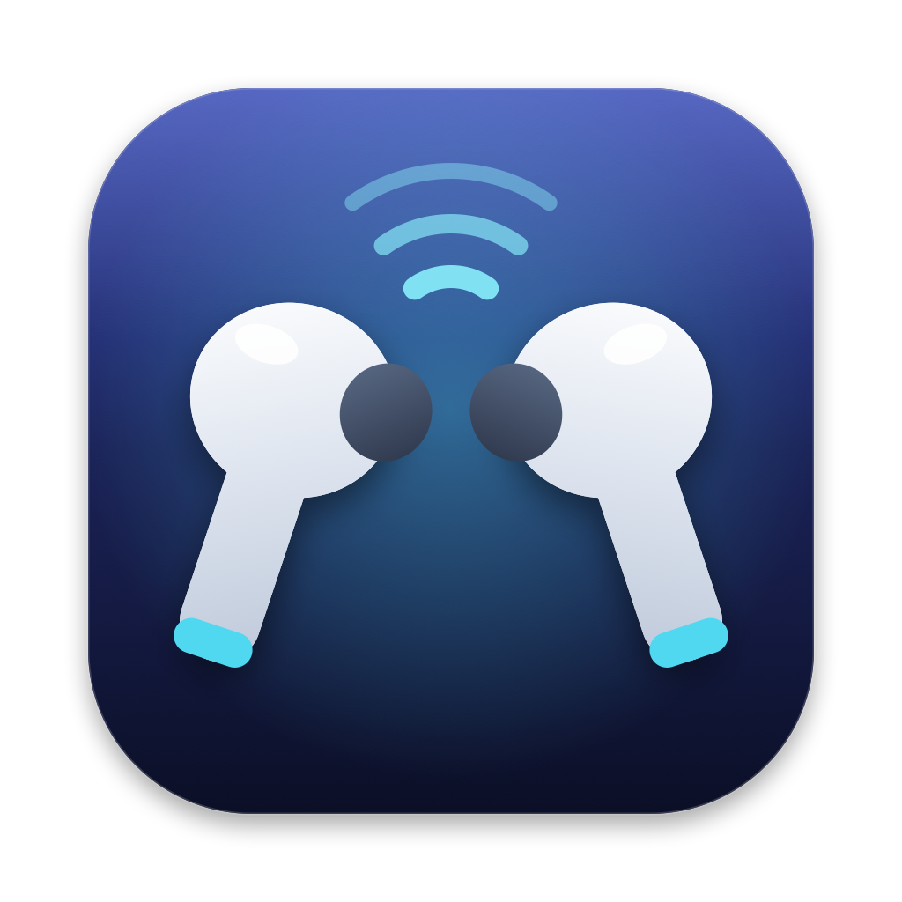
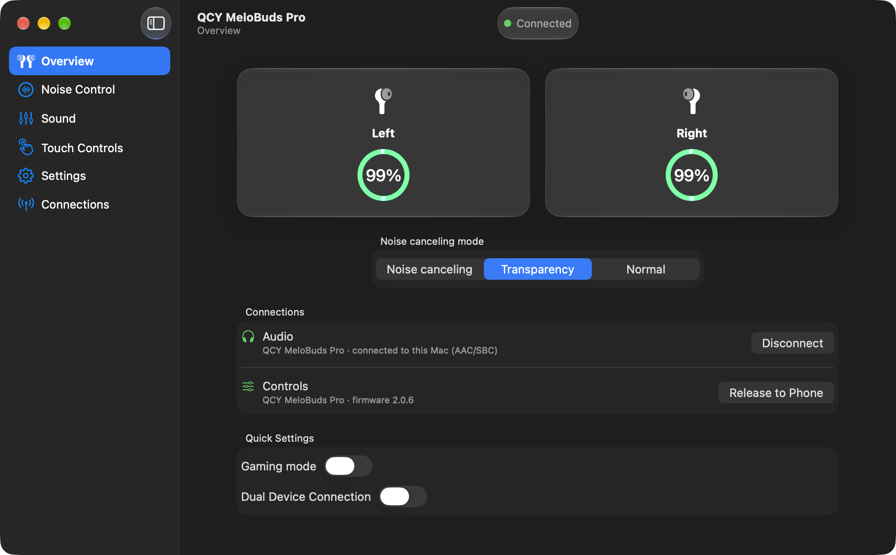
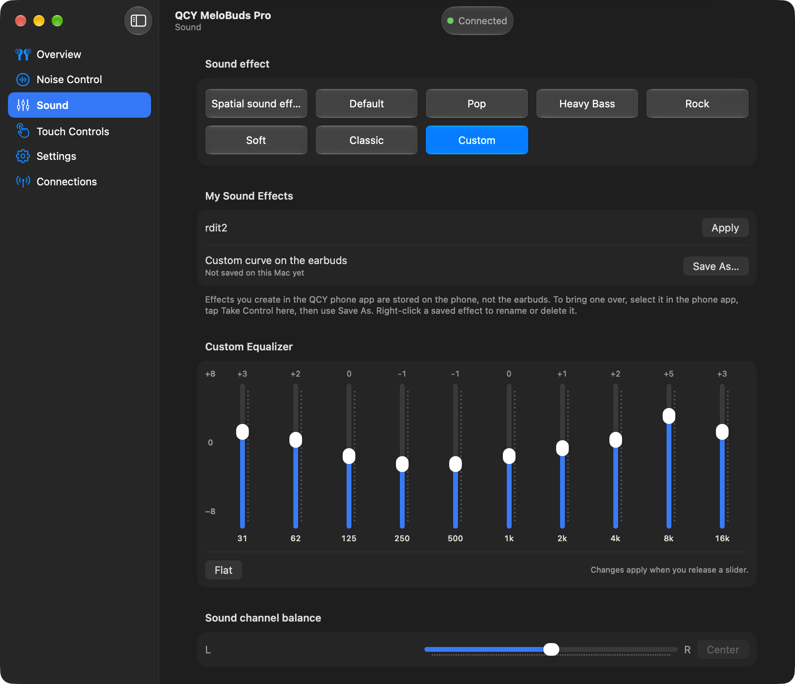
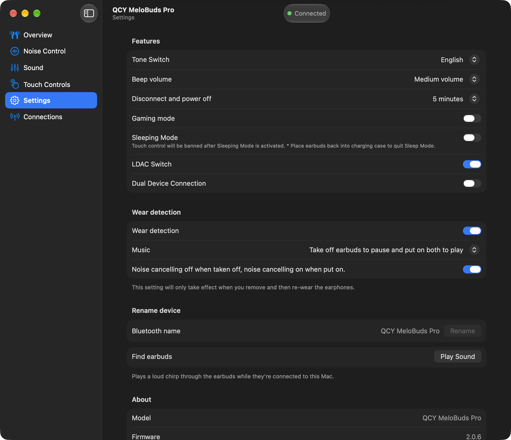
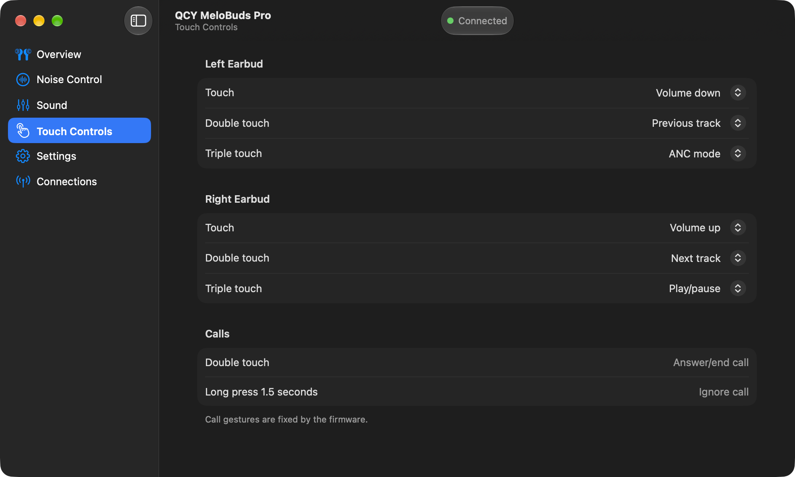
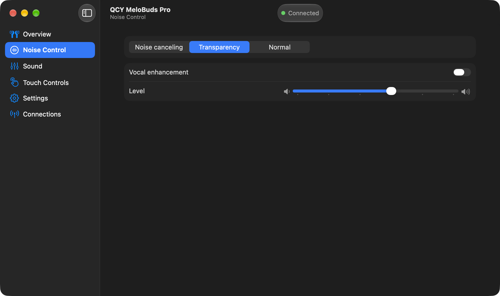

<p align="center">
  
</p>

<h1 align="center">BudBridge</h1>

<p align="center">
  <strong>An unofficial macOS app for QCY earbuds.</strong><br>
  Noise control, EQ, touch gestures and more, right from your Mac.
</p>

<p align="center">
  <a href="https://github.com/GabrielCR99/BudBridge/actions/workflows/ci.yml"></a>
  <a href="https://github.com/GabrielCR99/BudBridge/releases/latest"></a>
  
  
  <a href="LICENSE"></a>
</p>

<p align="center">
  <strong>English</strong> · <a href="README.pt-BR.md">Português (Brasil)</a>
</p>

---

BudBridge was built and tested with the **QCY MeloBuds Pro**. Like QCY's phone app, it builds its screens from each model's settings list, so it works with **101 QCY models** that use the same Bluetooth LE protocol.

<p align="center">
  
</p>

<table>
  <tr>
    <td width="50%"></td>
    <td width="50%"></td>
  </tr>
  <tr>
    <td align="center"><b>Sound</b>: presets, saved effects and a custom EQ</td>
    <td align="center"><b>Settings</b>: switches, wear detection and more</td>
  </tr>
  <tr>
    <td></td>
    <td></td>
  </tr>
  <tr>
    <td align="center"><b>Touch Controls</b>: what each tap does</td>
    <td align="center"><b>Noise Control</b>: modes, levels and scenes</td>
  </tr>
</table>

## Features

- **Connection:** connect or disconnect the earbuds' audio from this Mac in one click. Earbuds paired with this Mac connect automatically, and other QCY earbuds nearby appear under **Connections**.
- **Noise control:** noise canceling, transparency and off, with whatever your model offers: scenes, anti-wind, adaptive mode, transparency levels and vocal mode.
- **Sound:** QCY's EQ presets, a custom EQ (parametric or 10-band, depending on the model), and left/right balance.
- **My Sound Effects:** save custom EQ curves by name and re-apply them in one click.
- **Touch controls:** choose what each tap, double tap and long press does on each earbud.
- **Settings:** gaming mode, LDAC, dual device connection, sleep mode, prompt volume and language, auto power-off, wear detection, renaming and resets.
- **Battery:** left and right levels with charging state, plus the case on models that report it.
- **Find Earbuds:** plays a loud chirp so you can track them down.
- **Menu bar:** battery, noise mode and gaming mode, one click away.
- **Languages:** English and Brazilian Portuguese, following your Mac's language.

## Install

1. Download `BudBridge-<version>.zip` from the [latest release](https://github.com/GabrielCR99/BudBridge/releases/latest), unzip it, and move **BudBridge** to Applications.
2. The app is ad-hoc signed, not notarized, so macOS blocks the first launch. Open **System Settings › Privacy & Security** and click **Open Anyway**.
3. Allow Bluetooth access when asked. To use the earbuds for audio, pair them once in **System Settings › Bluetooth**.

**Requirements:** macOS 14 Sonoma or later (with Liquid Glass on macOS 26), and an internet connection once for each earbuds model, to download its settings list from QCY.

## Good to know

- **One controller at a time.** The earbuds accept a single control connection. While the QCY app on your phone holds it, the Mac can't connect. Use **Release to Phone** and **Take Control** to hand it over.
- **LDAC:** macOS has no LDAC encoder, so the Mac always streams AAC or SBC. The switch sets the earbuds' mode for Android sources.
- **LDAC and dual device connection** can't be on at the same time on models that have both. Changing either one restarts the earbuds, and BudBridge reconnects by itself.
- **Supported models:** the 101 models in [`Resources/Panels/catalog.json`](Resources/Panels/catalog.json). JieLi-based models (for example QCY H3 and MeloBuds N20/N30/N50) use a different transport and aren't supported.
- **Not available yet:** timed power-off, fit test, firmware updates, and the EQ on "ZR" models.
- Only the MeloBuds Pro has been tested on real hardware. Reports for other models are welcome in [Issues](https://github.com/GabrielCR99/BudBridge/issues).

## Building from source

Requires Xcode 26 (Swift 6.2) on macOS 14 or later.

```sh
./scripts/build-app.sh          # builds build/BudBridge.app (ad-hoc signed)
open build/BudBridge.app
swift test                      # 51 protocol, store and view-model tests
swift scripts/make-icon.swift   # regenerates the app icon (vector-drawn, no assets)
```

To try the Portuguese localization once: `open build/BudBridge.app --args -AppleLanguages '(pt-BR)'`.

### Architecture

MVVM with a coordinator (MVVM-C), in the spirit of objc.io's *App Architecture*:

```
Sources/
├── QCYKit/            Protocol layer: frames, commands, settings-list parser, device state
└── BudBridge/
    ├── App/           BudBridgeApp (scenes) and AppCoordinator (builds and wires everything)
    ├── Models/        Value types: ModelInfo, SoundEffect, NearbyDevice, Page
    ├── Services/      Model layer, no SwiftUI
    │   ├── HeadphonesStore   Single source of truth: state, settings list, commands
    │   ├── Bluetooth/        BLEConnection (CoreBluetooth), AudioConnection (IOBluetooth), FindTone
    │   └── Storage/          PanelRepository (settings lists), EffectLibrary (saved EQ curves),
    │                         RememberedEarbuds (last earbuds used)
    ├── ViewModels/    One per screen; Foundation and QCYKit only
    └── Views/         SwiftUI views that render view-model values and forward actions
```

- **Data flows one way:** Views → ViewModels → `HeadphonesStore` → `ControlTransport` → earbuds. Notifications from the earbuds come back into the store, and views observe it through their view models.
- **Testable:** services sit behind small protocols (`ControlTransport`, `PanelProviding`, `AudioConnecting`, `FindTonePlaying`), so the tests run the real store and view models against fakes.
- **Modern Swift:** Swift 6 language mode with main-actor default isolation, `@Observable`, isolated conformances, typed throws and Swift Testing.
- **SwiftLint** runs on every build through its build-tool plugin and passes `--strict` with no violations.

### Localization

The app's text lives in String Catalogs (`Resources/Localizable.xcstrings` and `InfoPlist.xcstrings`), compiled by `scripts/build-app.sh`. Each model's settings come from QCY in the same language, falling back to English when QCY has no Portuguese version, and their labels are tidied for display (for example "5Minute" becomes "5 minutes").

### Settings lists

QCY's settings lists aren't included in this repository or the app. Like the phone app, BudBridge downloads the list for the connected model and firmware and caches it in `~/Library/Application Support/BudBridge/Panels`. The tests use small fixtures (`Tests/Fixtures/Panels`) that keep the structure and numbers of real lists, with the text rewritten.

### CI/CD

- **CI** ([`ci.yml`](.github/workflows/ci.yml)) runs on every pull request, every push to `main` or `development`, and weekly:
  - **Security scan:** [gitleaks](https://github.com/gitleaks/gitleaks) checks the whole history for exposed secrets, and `scripts/check-forbidden-files.sh` fails if files such as `.env`, certificates or provisioning profiles are tracked.
  - **Build and test** on macOS 26: `swift test`, then `scripts/build-app.sh`. The zipped app is kept as a workflow artifact for 7 days.
- **Release** ([`release.yml`](.github/workflows/release.yml)) runs by hand from **Actions › Release › Run workflow** with a version such as `1.1.0`. It checks the version and that it runs on `main`, runs the tests, builds the app with that version, and publishes the tag `v1.1.0` as a GitHub Release with the zip and its SHA-256 checksum.

Actions are pinned to commit SHAs, jobs get read-only permissions (only the release job can write), and Dependabot proposes updates weekly.

### Branches

- **`development`** collects the work for the next release: every pull request targets it.
- **`main`** holds released code. When `development` is ready, it's merged into `main` with one pull request, and releases are published from `main`.

Both branches are protected: changes land only through pull requests that pass both CI jobs, with no force pushes or deletion.

<details>
<summary><strong>Protocol notes</strong> (worked out from QCY's Android app, version 4.0.7)</summary>

<br>

The earbuds expose GATT service `A001` on a separate LE identity named "&lt;name&gt;-APP", at the Classic Bluetooth address + 1.

| Characteristic | Properties | Use |
|---|---|---|
| `1001` | write without response | command frames |
| `1002` | read, notify | setting frames; reading it returns every setting |
| `0007` | read | firmware, `L.L.L R.R.R` |
| `0008` | read, notify | battery `[L, R, case]`, bit 7 = charging |
| `000B` | read, write | legacy EQ slot |
| `000D` | read, write | touch controls, `[gesture, action]` pairs |

A frame is `FF <len> { <cmd> <n> <payload> }*`. Request a value with `FE 01 <cmd>`. Switches are written as `1` (on) or `2` (off) and read back as `1` or `0`.

| Command | Setting | Payload |
|---|---|---|
| `01` / `03` | Reset settings / factory reset | none |
| `09` | Gaming mode | switch |
| `10` | Sleep mode | switch |
| `16` | Balance | 0–100 (50 = center) |
| `17` | Noise control | `[mode, scene, level]`, e.g. `02 00 00` off, `01 01‑03 00‑02` ANC scenes, `01 04 00` anti-wind, `01 05 00` adaptive, `03 01 01‑06` transparency, `03 02 00` vocal |
| `18` | Name | UTF-8 |
| `19` | Prompt language | ASCII, `WQ00` English, `WQ01` Chinese |
| `1D` | Prompt volume | 4 / 6 / 8 / 10 |
| `1F` | Power off after disconnect | u16 LE minutes, `FFFF` = never |
| `22` | Equalizer | `[id, global gain s16]` + 20 × `[freq u16, gain×100 s16, Q×100 u16, type]` (`04` shelf, `00` peak, `FF` user band) |
| `23` | LDAC | switch |
| `24` | Dual device connection | switch |
| `2C` | Wear detection | `[enabled, music 0‑3, ANC follows wear]` |

EQ presets and option labels come from the model's settings list. The MeloBuds Pro advertises vendor ID `0x4D4A`, which is model ID 19786 in QCY's catalog.

</details>

## License

BudBridge's source code is released under the [MIT License](LICENSE). The license covers the code in this repository only, not QCY's trademarks, apps or settings lists, which aren't included.

## Disclaimer

BudBridge is an independent project. It is not affiliated with, endorsed by, or sponsored by QCY. "QCY" and "MeloBuds" are trademarks of their owner and are used here only to describe compatibility. The protocol was worked out from QCY's Android app and the author's own earbuds, for interoperability. No QCY code, apps or settings lists are redistributed.
