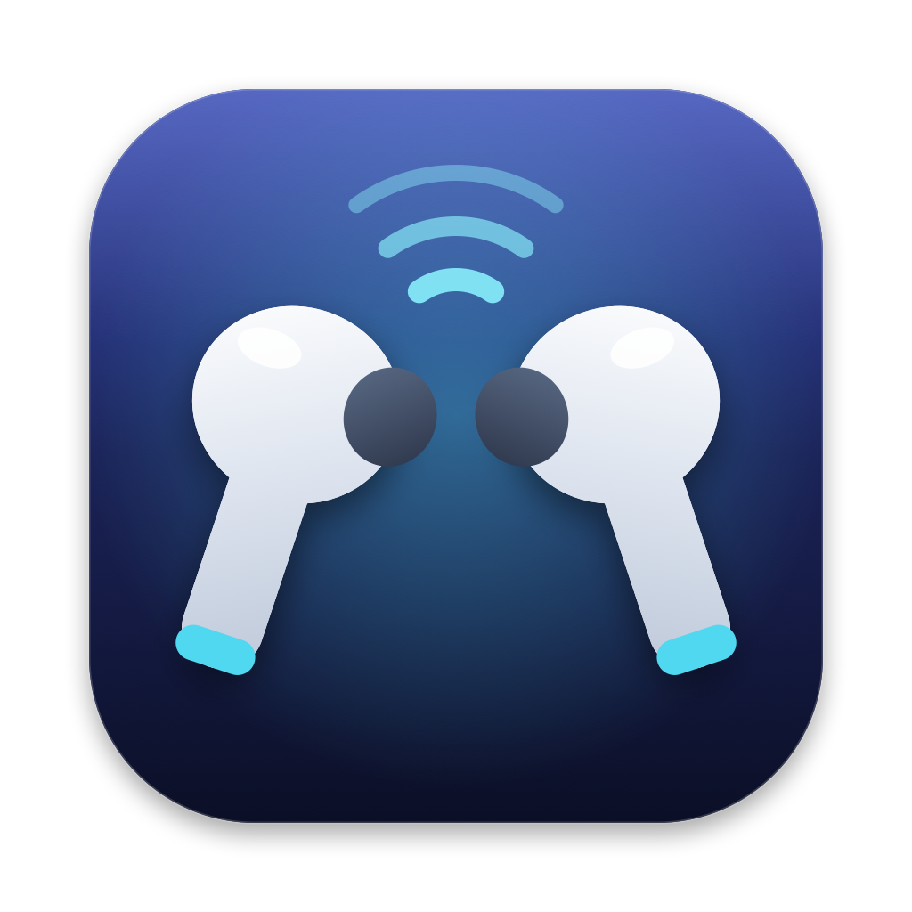
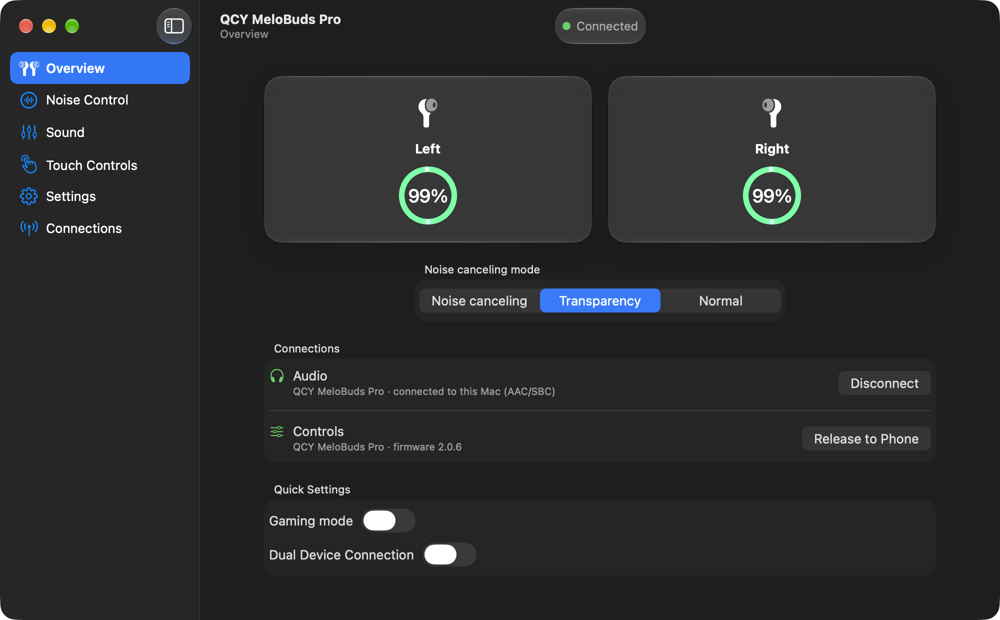
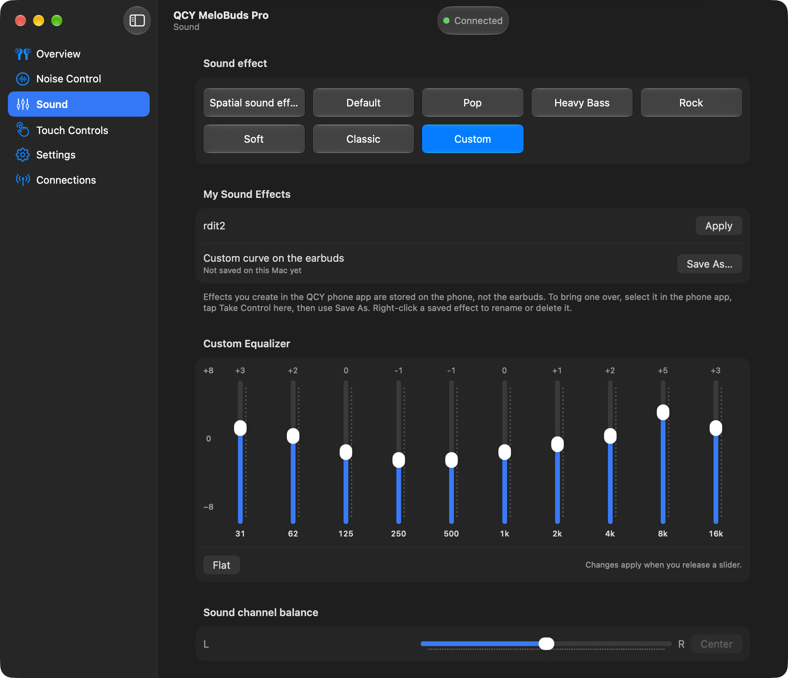
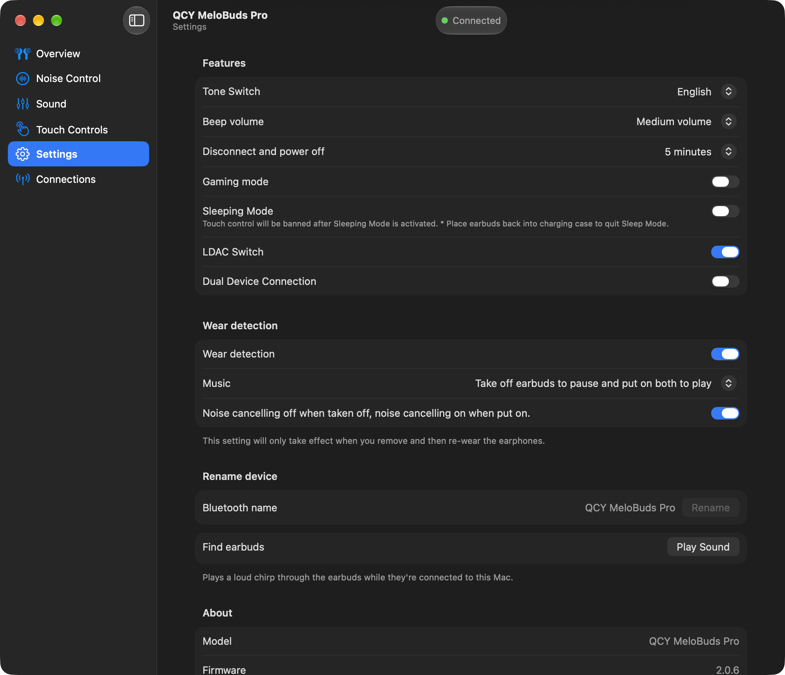
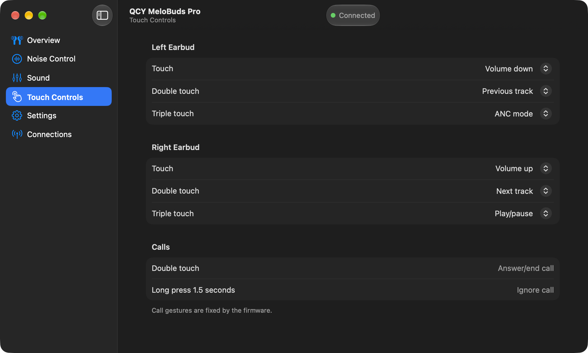
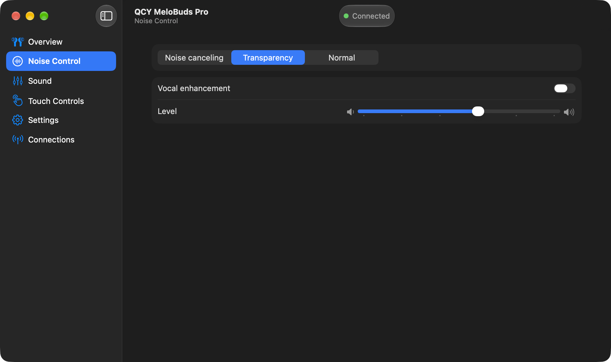

<p align="center">
  
</p>

<h1 align="center">BudBridge</h1>

<p align="center">
  <strong>Um app não oficial para macOS para fones QCY.</strong><br>
  Controle de ruído, equalizador, gestos de toque e mais, direto do seu Mac.
</p>

<p align="center">
  <a href="https://github.com/GabrielCR99/BudBridge/actions/workflows/ci.yml"></a>
  <a href="https://github.com/GabrielCR99/BudBridge/releases/latest"></a>
  
  
  <a href="LICENSE"></a>
</p>

<p align="center">
  <a href="README.md">English</a> · <strong>Português (Brasil)</strong>
</p>

---

O BudBridge foi criado e testado com o **QCY MeloBuds Pro**. Assim como o app da QCY para celular, ele monta as telas a partir da lista de ajustes de cada modelo, por isso funciona com **101 modelos QCY** que usam o mesmo protocolo Bluetooth LE.

<p align="center">
  
</p>

<table>
  <tr>
    <td width="50%"></td>
    <td width="50%"></td>
  </tr>
  <tr>
    <td align="center"><b>Som</b>: predefinições, efeitos salvos e equalizador personalizado</td>
    <td align="center"><b>Ajustes</b>: chaves, detecção de uso e mais</td>
  </tr>
  <tr>
    <td></td>
    <td></td>
  </tr>
  <tr>
    <td align="center"><b>Controles de Toque</b>: o que cada toque faz</td>
    <td align="center"><b>Controle de Ruído</b>: modos, níveis e cenários</td>
  </tr>
</table>

<p align="center"><sub>As capturas de tela mostram o app em inglês; ele também está traduzido para o português do Brasil.</sub></p>

## Recursos

- **Conexão:** conecte ou desconecte o áudio dos fones neste Mac com um clique. Fones emparelhados com este Mac se conectam sozinhos, e outros fones QCY por perto aparecem em **Conexões**.
- **Controle de ruído:** cancelamento de ruído, transparência e desligado, com tudo o que o seu modelo oferece: cenários, anti-vento, modo adaptativo, níveis de transparência e realce de voz.
- **Som:** as predefinições de equalizador da QCY, um equalizador personalizado (paramétrico ou de 10 bandas, conforme o modelo) e balanço entre esquerdo e direito.
- **Meus Efeitos Sonoros:** salve curvas de equalizador com um nome e aplique de novo com um clique.
- **Controles de toque:** escolha o que cada toque, toque duplo e toque longo faz em cada fone.
- **Ajustes:** modo jogo, LDAC, conexão com dois dispositivos, modo de dormir, volume e idioma dos avisos, desligamento automático, detecção de uso, renomear e redefinir.
- **Bateria:** nível dos fones esquerdo e direito com indicação de carregamento, e do estojo nos modelos que informam.
- **Encontrar os fones:** toca um som alto para você achar os fones.
- **Barra de menus:** bateria, modo de ruído e modo jogo a um clique.
- **Idiomas:** inglês e português do Brasil, seguindo o idioma do seu Mac.

## Instalação

1. Baixe o `BudBridge-<versão>.zip` da [versão mais recente](https://github.com/GabrielCR99/BudBridge/releases/latest), descompacte e mova o **BudBridge** para Aplicativos.
2. O app é assinado ad-hoc, sem notarização da Apple, então o macOS bloqueia a primeira abertura. Abra **Ajustes do Sistema › Privacidade e Segurança** e clique em **Abrir Mesmo Assim**.
3. Permita o acesso ao Bluetooth quando o app pedir. Para usar os fones como saída de áudio, emparelhe-os uma vez em **Ajustes do Sistema › Bluetooth**.

**Requisitos:** macOS 14 Sonoma ou posterior (com Liquid Glass no macOS 26) e conexão com a internet uma vez para cada modelo de fone, para baixar a lista de ajustes da QCY.

## Bom saber

- **Um controlador por vez.** Os fones aceitam uma única conexão de controle. Enquanto o app da QCY no celular estiver conectado, o Mac não consegue se conectar. Use **Liberar para o Celular** e **Assumir Controle** para alternar.
- **LDAC:** o macOS não tem codificador LDAC, então o Mac sempre transmite em AAC ou SBC. A chave muda o modo dos fones para fontes Android.
- **LDAC e conexão com dois dispositivos** não podem ficar ligados ao mesmo tempo nos modelos que têm os dois. Mudar qualquer um reinicia os fones, e o BudBridge se reconecta sozinho.
- **Modelos compatíveis:** os 101 modelos em [`Resources/Panels/catalog.json`](Resources/Panels/catalog.json). Modelos com chip JieLi (por exemplo QCY H3 e MeloBuds N20/N30/N50) usam outro transporte e não são compatíveis.
- **Ainda não disponível:** desligamento programado, teste de encaixe, atualização de firmware e o equalizador dos modelos "ZR".
- Só o MeloBuds Pro foi testado em hardware real. Relatos sobre outros modelos são bem-vindos em [Issues](https://github.com/GabrielCR99/BudBridge/issues).

## Compilando o código

Requer Xcode 26 (Swift 6.2) no macOS 14 ou posterior.

```sh
./scripts/build-app.sh          # gera build/BudBridge.app (assinado ad-hoc)
open build/BudBridge.app
swift test                      # 54 testes de protocolo, store e view models
swift scripts/make-icon.swift   # gera o ícone do app de novo (desenhado em vetor, sem imagens)
```

Para testar a tradução em português uma vez: `open build/BudBridge.app --args -AppleLanguages '(pt-BR)'`.

### Arquitetura

MVVM com coordinator (MVVM-C), no espírito do livro *App Architecture* da objc.io:

```
Sources/
├── QCYKit/            Camada de protocolo: frames, comandos, leitura da lista de ajustes, estado do fone
└── BudBridge/
    ├── App/           BudBridgeApp (cenas) e AppCoordinator (cria e conecta tudo)
    ├── Models/        Tipos de valor: ModelInfo, SoundEffect, NearbyDevice, Page
    ├── Services/      Camada de modelo, sem SwiftUI
    │   ├── HeadphonesStore   Fonte única da verdade: estado, lista de ajustes, comandos
    │   ├── Bluetooth/        BLEConnection (CoreBluetooth), AudioConnection (IOBluetooth), FindTone
    │   └── Storage/          PanelRepository (listas de ajustes), EffectLibrary (curvas salvas),
    │                         RememberedEarbuds (últimos fones usados)
    ├── ViewModels/    Um por tela; só Foundation e QCYKit
    └── Views/         Views SwiftUI que mostram valores dos view models e repassam ações
```

- **Fluxo de dados em uma direção:** Views → ViewModels → `HeadphonesStore` → `ControlTransport` → fones. As notificações dos fones voltam para a store, e as views a observam pelos seus view models.
- **Testável:** os serviços ficam atrás de protocolos pequenos (`ControlTransport`, `PanelProviding`, `AudioConnecting`, `FindTonePlaying`), então os testes rodam a store e os view models reais com fakes.
- **Swift moderno:** modo de linguagem Swift 6 com isolamento padrão no main actor, `@Observable`, conformidades isoladas, typed throws e Swift Testing.
- **SwiftLint** roda em todo build pelo plugin de build e passa no `--strict` sem nenhuma violação.

### Localização

Os textos do app ficam em String Catalogs (`Resources/Localizable.xcstrings` e `InfoPlist.xcstrings`), compilados pelo `scripts/build-app.sh`. Os ajustes de cada modelo vêm da QCY no mesmo idioma, em inglês quando a QCY não tem versão em português, e os rótulos são ajustados para exibição (por exemplo, "5Minute" vira "5 minutos").

### Listas de ajustes

As listas de ajustes da QCY não estão neste repositório nem no app. Assim como o app para celular, o BudBridge baixa a lista do modelo e firmware conectados e guarda em `~/Library/Application Support/BudBridge/Panels`. Os testes usam fixtures pequenas (`Tests/Fixtures/Panels`) que mantêm a estrutura e os números de listas reais, com o texto reescrito.

### CI/CD

- **CI** ([`ci.yml`](.github/workflows/ci.yml)) roda em todo pull request, em todo push para `main` ou `development` e toda semana:
  - **Security scan:** o [gitleaks](https://github.com/gitleaks/gitleaks) procura segredos expostos em todo o histórico, e o `scripts/check-forbidden-files.sh` falha se arquivos como `.env`, certificados ou perfis de provisionamento estiverem versionados.
  - **Build and test** no macOS 26: `swift test` e depois `scripts/build-app.sh`. O app compactado fica disponível como artefato do workflow por 7 dias.
- **Release** ([`release.yml`](.github/workflows/release.yml)) é disparado manualmente em **Actions › Release › Run workflow** com uma versão como `1.1.0`. Ele confere a versão e se está rodando na `main`, roda os testes, gera o app com essa versão e publica a tag `v1.1.0` como um GitHub Release com o zip e o checksum SHA-256.
- **Claude Review** ([`claude-review.yml`](.github/workflows/claude-review.yml)) revisa todo pull request que não é rascunho com o [Claude Code](https://github.com/anthropics/claude-code-action): comentários nas linhas alteradas e um comentário de resumo. Ele precisa do [Claude GitHub App](https://github.com/apps/claude) no repositório e de um secret `CLAUDE_CODE_OAUTH_TOKEN` (gerado com `claude setup-token`). Pull requests de forks e do Dependabot são ignorados.

As actions são fixadas por SHA de commit, os jobs têm permissão só de leitura (só o job de release pode escrever no repositório, e o job de revisão pode comentar em pull requests) e o Dependabot propõe atualizações toda semana.

### Branches

- **`development`** reúne o trabalho da próxima versão: todo pull request vai para ela.
- **`main`** tem o código lançado. Quando a `development` está pronta, ela é mesclada na `main` com um pull request, e as versões são publicadas a partir da `main`.

As duas branches são protegidas: mudanças entram só por pull requests que passam nos dois jobs de CI, sem force push nem exclusão.

<details>
<summary><strong>Notas do protocolo</strong> (descobertas a partir do app Android da QCY, versão 4.0.7)</summary>

<br>

Os fones expõem o serviço GATT `A001` em uma identidade LE separada chamada "&lt;nome&gt;-APP", no endereço Bluetooth Classic + 1.

| Característica | Propriedades | Uso |
|---|---|---|
| `1001` | escrita sem resposta | frames de comando |
| `1002` | leitura, notificação | frames de ajustes; a leitura retorna todos os ajustes |
| `0007` | leitura | firmware, `L.L.L R.R.R` |
| `0008` | leitura, notificação | bateria `[E, D, estojo]`, bit 7 = carregando |
| `000B` | leitura, escrita | slot de equalizador antigo |
| `000D` | leitura, escrita | controles de toque, pares `[gesto, ação]` |

Um frame é `FF <tam> { <cmd> <n> <dados> }*`. Peça um valor com `FE 01 <cmd>`. Chaves são escritas como `1` (ligado) ou `2` (desligado) e lidas como `1` ou `0`.

| Comando | Ajuste | Dados |
|---|---|---|
| `01` / `03` | Redefinir ajustes / restaurar padrões de fábrica | nenhum |
| `09` | Modo jogo | chave |
| `10` | Modo de dormir | chave |
| `16` | Balanço | 0–100 (50 = centro) |
| `17` | Controle de ruído | `[modo, cenário, nível]`, ex.: `02 00 00` desligado, `01 01‑03 00‑02` cenários de ANC, `01 04 00` anti-vento, `01 05 00` adaptativo, `03 01 01‑06` transparência, `03 02 00` voz |
| `18` | Nome | UTF-8 |
| `19` | Idioma dos avisos | ASCII, `WQ00` inglês, `WQ01` chinês |
| `1D` | Volume dos avisos | 4 / 6 / 8 / 10 |
| `1F` | Desligar após desconectar | minutos em u16 LE, `FFFF` = nunca |
| `22` | Equalizador | `[id, ganho global s16]` + 20 × `[freq u16, ganho×100 s16, Q×100 u16, tipo]` (`04` shelf, `00` pico, `FF` banda do usuário) |
| `23` | LDAC | chave |
| `24` | Conexão com dois dispositivos | chave |
| `2C` | Detecção de uso | `[ativado, música 0‑3, ANC acompanha o uso]` |

As predefinições de equalizador e os rótulos das opções vêm da lista de ajustes do modelo. O MeloBuds Pro anuncia o vendor ID `0x4D4A`, que é o modelo 19786 no catálogo da QCY.

</details>

## Licença

O código-fonte do BudBridge é distribuído sob a [Licença MIT](LICENSE). A licença cobre apenas o código deste repositório, não as marcas, os apps ou as listas de ajustes da QCY, que não estão incluídos.

## Aviso legal

O BudBridge é um projeto independente. Ele não é afiliado, endossado ou patrocinado pela QCY. "QCY" e "MeloBuds" são marcas registradas de seu proprietário e são usadas aqui apenas para indicar compatibilidade. O protocolo foi descoberto a partir do app Android da QCY e dos fones do próprio autor, para fins de interoperabilidade. Nenhum código, app ou lista de ajustes da QCY é redistribuído.
